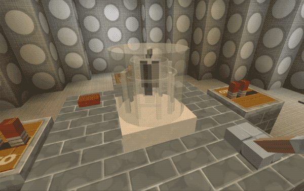
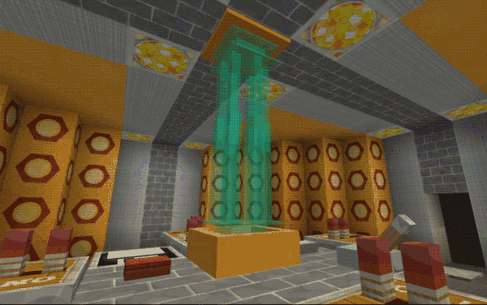
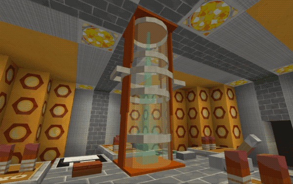
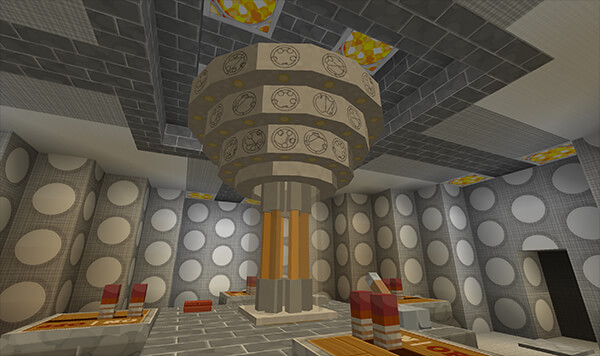
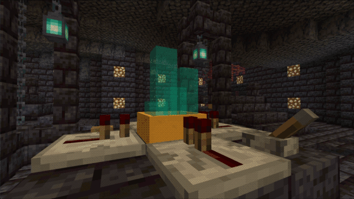
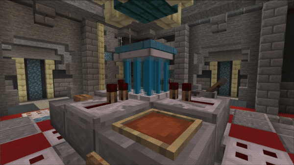
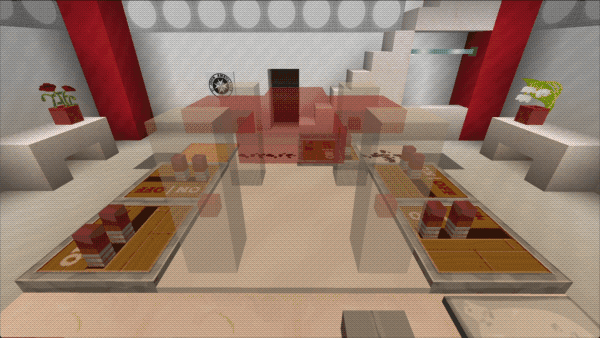
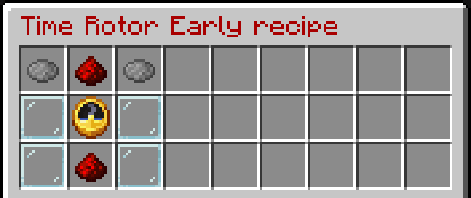
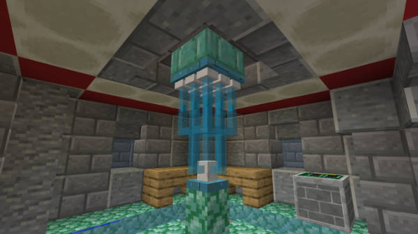

import Recipe from "@site/src/components/Recipe";

# Time Rotor

If you are using the [TARDIS-Resource-Pack](/resource-packs) you can add an animated time rotor to your console (or grow a DELTA, HOSPITAL, MECHANICAL, ROTOR, or TOM console from a TARDIS seed block).

## Rotor Types

There are 7 time rotor types.

### Early era



### Ninth / tenth era



### Eleventh era



### Twelfth era (not animated)



### Delta



### Engine



### Hospital



## Adding a Time Rotor

To add a time rotor to an existing console:

1. Craft a TARDIS Time Rotor &mdash; see recipes below
2. Place an item frame in the desired location on the TARDIS console
3. Place the crafted time rotor into the item frame
4. Run the command `/tardis update rotor`
5. Click the time rotor item frame

## Changing a Time Rotor

Time rotors are locked (and the item frame made invisible) when you update them. In order to make changes to the time rotor you need to unlock it.

1. Run the command `/tardis update rotor unlock`
2. Make changes to the item frame and rotor
3. Re-update the rotor with the command `/tardis update rotor`

## Recipes

The crafting recipes for the six time rotors are:



```
DYE       | REDSTONE | DYE
GLASSPANE | CLOCK    | GLASSPANE
GLASSPANE | REDSTONE | GLASSPANE
```

Change the dye colours for each rotor:

* Early &mdash; Gray <span class="rc-item rc-minecraft_gray_dye"></span> 
* Tenth &mdash; Cyan <span class="rc-item rc-minecraft_cyan_dye"></span> 
* Eleventh &mdash; Brown <span class="rc-item rc-minecraft_brown_dye"></span> 
* Twelfth &mdash; Orange <span class="rc-item rc-minecraft_orange_dye"></span> 
* Delta &mdash; Purple <span class="rc-item rc-minecraft_purple_dye"></span> 
* Engine &mdash; Blue <span class="rc-item rc-minecraft_blue_dye"></span> 
* Hospital &mdash; White <span class="rc-item rc-minecraft_white_dye"></span> 

Use this command to see the recipes in game:

```
/tardisrecipe time-rotor-[early|tenth|eleventh|twelfth|delta|engine|hospital]
```

There is also a Rotor Engine (as seen in the Mechanical console) - `/tardisrecipe time-engine`.



| Ingredients | Crafting recipe | Difficulty |
| ----------- | --------------- | ------------- |
| [Blue Dye](https://minecraft.wiki/w/Blue_Dye)<br/>[Redstone](https://minecraft.wiki/w/Redstone)<br/>[Clock](https://minecraft.wiki/w/Clock)<br/>[Glass Pane](https://minecraft.wiki/w/Glass_Pane) | <Recipe icons={['blue-dye','redstone','blue-dye','glass-pane','clock','glass-pane','glass-pane','redstone','glass-pane','time-rotor-engine']} /> | easy |
| [Blue Dye](https://minecraft.wiki/w/Blue_Dye)<br/>[Redstone Block](https://minecraft.wiki/w/Redstone_Block)<br/>[Clock](https://minecraft.wiki/w/Clock)<br/>[Glass Pane](https://minecraft.wiki/w/Glass_Pane) | <Recipe icons={['blue-dye','redstone-block','blue-dye','glass-pane','clock','glass-pane','glass-pane','redstone-block','glass-pane','time-rotor-engine']} /> | hard |

## Custom time rotors

From TARDIS v5.5.0 you can add your own custom time rotors to the plugin - for more information, see the [Custom Time Rotors](custom-rotors) page.
